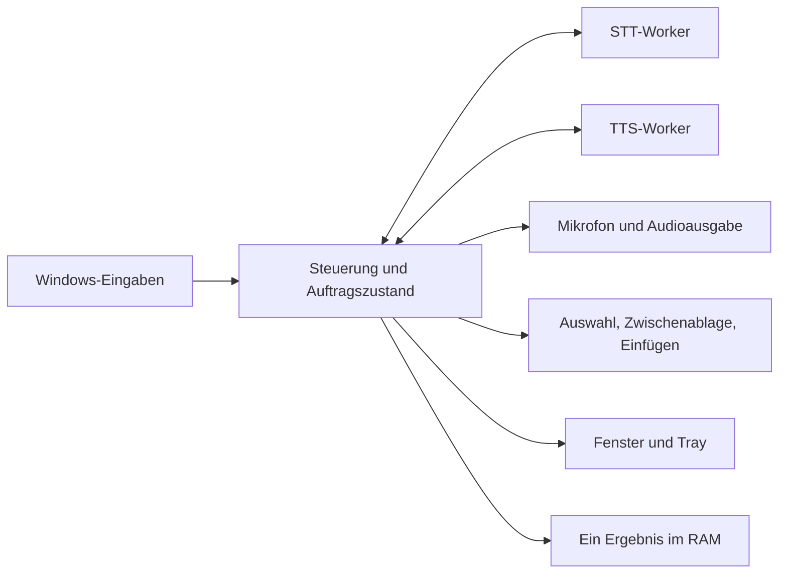

# Hugin V1 Umsetzungsplan

Stand: 14.10.2026. Feature-Loop mit Brownfield-Migration. Die Nutzerbestätigung trägt Spec und Planung; dieser Auftrag umfasst keine Implementierung oder produktive Aktivierung. [spec.md](spec.md) ist der Verhaltensvertrag, [tasks.md](tasks.md) die ausführbare Reihenfolge.

## Architektur und Entscheidungen

- DEC-001: Python 3.12.10 mit einer leichten Controller-Umgebung und getrennten, gepinnten STT-/TTS-Umgebungen. Unterschiedliche NumPy-Versionen und CUDA-Abhängigkeiten bleiben isoliert. Neue Umgebungen unter Hugin herstellen; keine bestehende venv verschieben.
- DEC-002: Tkinter/ttk für ein kleines Windows-Fenster; Tkinter/Tk 8.6 sind im vorhandenen Python lesend nachgewiesen. pystray 0.19.5 und Pillow 12.3.0 sind aus dem Bestand bekannte Kandidaten für Tray/Icon. Alle GUI-Zugriffe laufen auf dem UI-Thread. Keine WebView, Node- oder Frontend-Laufzeit.
- DEC-003: Ein Windows-Eingabeowner mit dedizierter Message-Loop. WH_MOUSE_LL verarbeitet XBUTTON1/2 kurz und übergibt Ereignisse an die Steuerung. Strg+Alt+D/V mit MOD_NOREPEAT; Escape nur für aktive Aufträge. Maus-DOWN/UP paarweise konsumieren; den gemessenen INJECTED-Fall akzeptieren, LOWER_IL_INJECTED abweisen. Der Hook führt weder Modellarbeit noch Clipboard-/Audioarbeit aus.
- DEC-004: Direkte Befehle, keine künstliche Alt+Y-Weiterleitung und keine Suche nach einem Whispering-Fenster. Registrierungsfehler begrenzen sichtbar die Funktion; kein grünes Gesamt-Bereit bei Konflikt.
- DEC-005: Controller besitzt Mikrofon und native waveOut-Ausgabe. Vorhandenen PCM-Player gezielt übernehmen/härten, inklusive MIT-Hinweis. Aufnahme-Kandidat ist sounddevice RawInputStream mit PCM16/Mono/16 kHz; Version 0.5.1 und Geräte-/Treiberverhalten werden in T001/T004 isoliert validiert und gelockt. Unterstützt ein Standardgerät 16 kHz nicht, Fehler anzeigen; Resampling erst nach explizitem überprüftem Planupdate.
- DEC-006: Zwei kontrollierte Worker, kein HTTP-Server im Endzustand. Nur eine GPU-Inferenz gleichzeitig. Worker können resident bleiben, sofern gemessene Reserven ausreichen. Initial Whisper-Idle-Offload nach 90 Sekunden; bei Residenzkonflikt expliziter, gemessener Offload-/Reload-Pfad statt zufälliger OOMs.
- DEC-007: Hugin-Code für Steuerung, UI und Windows-Grenzen selbst schreiben. Bewährte MIT-Komponenten selektiv mit Herkunft/Notices übernehmen. Whisperings AGPL-Quellen dienen als Verhaltensreferenz; keine ungeprüfte Quellübernahme. Die vollständigen alten Apps nicht vendoren.



## Kleines Interface

Eine Ansicht, initial ungefähr 500 × 520 logische Pixel, flexibel und DPI-tauglich. Systemtypografie, klare Beschriftung, wenige nordische Akzente. Farbe ergänzt Text/Statussymbol und ist nie alleiniger Zustandsträger.

```text
Hugin                                   Lokal · GPU
Bereit / Aufnahme / Verarbeitung / Vorlesen / Fehler

Diktieren   Zurück-Taste oder Strg+Alt+D · erneut: fertig
Vorlesen    Text markieren · Vorwärts-Taste oder Strg+Alt+V · erneut: Stopp
Abbrechen   Escape während einer Aktion

Stimme      [ Freya – ruhig, weiblich | Tyr – männlich ]

Letztes Diktat
[ schreibgeschützter Text, bei Bedarf scrollbar       ]
[Kopieren] [Löschen]

Komponenten: Diktieren bereit · Vorlesen wird vorbereitet
Verständlicher letzter Fehler, falls vorhanden
[Diagnose kopieren]
```

- Kein Hauptfenster beim Login, keine automatische Fokusübernahme, kein Always-on-top. Tray-Menü: Öffnen, Diagnose kopieren, Beenden. Explorer-Neustart registriert das Icon neu.
- Keine Aufnahme-/Vorlesestartbuttons im Fenster: Tastenhinweise erklären die vereinbarte Bedienung, ohne eine neue Fokus-/Zielübergabe einzuführen.
- Kopieren- und Löschen-Buttons deaktivieren, wenn kein Ergebnis vorhanden ist. Nach Ablauf auch sichtbaren Text entfernen.
- Freya/Tyr-Auswahl schreibt nur die lokale Nutzerauswahl; technische TOML-Konfiguration bleibt Agent-owned. UI-Wechsel während TTS beendet den Auftrag, startet ihn nicht neu.

## Auftrags- und Abbruchvertrag

Die Steuerung serialisiert Befehle. Jeder Auftrag erhält eine monoton neue Generation und eine zufällige Instanz-ID. Nutzdaten müssen zur Instanz, Generation, Engine und zulässigen Zustandsphase passen. Jeder Übergang, jede IPC-Nachricht und jeder Audioblock prüft das; veraltete Daten erzeugen weder Audio noch Textübergabe.

Ressourcenbereinigung hat einen getrennten Owner: entwertete Engine-Operationen bleiben bis terminal/Exit im In-flight-Verzeichnis. Ein zu deren tatsächlichem Engine-Slot passendes terminales Ereignis darf den Slot auch bei alter Nutzer-Generation freigeben; es darf keinen neueren Nutzerauftrag abschließen oder UI/Text/Audio veröffentlichen. CANCELLING enthält deshalb die Auftragsart. Während TTS-Abbruch darf ein neuer Diktatauftrag nach Audio-Stopp RECORDING werden; nur seine spätere GPU-Inferenz wartet auf die alte Engine-Operation. Ein Diktat-Abbruch blockiert dagegen weitere Diktat-Toggles bis zur eigenen Mikrofon-/Übergabebereinigung.

Bei Diktatstart während TTS:

1. TTS-Generation entwerten, Audioqueue sperren/leeren und waveOutReset ausführen.
2. Rückkehr/Fehler des eigenen Audiostopps prüfen. Bei Fehler Mikrofon nicht öffnen und sichtbar fehlschlagen.
3. Nach Ausgabestopp Mikrofonaufnahme starten. Qwen-Abbruch parallel anfordern.
4. Vor Whisper-GPU-Inferenz auf terminales Qwen-Ende warten. Terminal bedeutet Stream geschlossen und zugehörige GPU-Arbeit beendet, nicht nur Cancel empfangen.
5. Nach Timeout nur den eigenen Worker über gehaltene Prozess-/Job-Handles beenden; bestätigten Exit abwarten. Hängt die Bereinigung, keine konkurrierende GPU-Arbeit starten.

Escape nutzt denselben Abbruchpfad. Die Einfügeübergabe ist ein serialisierter Commit-Punkt; unmittelbar davor wird der aktuelle Auftragszustand geprüft. Bereits an Windows übergebene Eingaben werden nicht mit Undo kompensiert. Ein bewusstes Nutzer-Abbrechen startet keinen automatischen Retry.

Worker-Initialisierung braucht einen eigenen Watchdog: der alte Qwen-Reader beginnt seinen Command-Reader erst nach Modell-/DLL-Warmup. Ein verschobener Reader-Thread vor nativer Initialisierung ist ohne Nachweis keine sichere Reparatur.

## Auswahl, Einfügen und Zwischenablage

Ein gemeinsamer Dienst besitzt alle automatischen Clipboard-Transaktionen. Er bindet die Erfassung an Fenster/Control-Identität, prüft Modifier, sichert unterstützte Formate und wartet begrenzt auf eine neue Auswahl. Alte Zwischenablageinhalte gelten nicht als Auswahl.

Zugesicherte Pilotfälle: Unicode-Text, HTML, RTF, DIB/DIBV5-Bilder und Dateilisten. Nicht sicher kopierbare Custom-/Delayed-Formate oder ein überschrittenes Snapshot-Budget führen vor Mutation zu einem klaren Fehler; es gibt kein verlustbehaftetes Text-only-Backup. Ein UI-Automation-Leseweg kann nach einem gezielten Nachweis für sonst nicht erfassbare Auswahl ergänzt werden und ist keine pauschale V1-Zusage.

Automatische Wiederherstellung nur, solange Clipboard-Sequence und Transaktion noch die eigenen sind. Parallel vom Nutzer kopierte Daten haben Vorrang. Bei Einfügen kommt hinzu: Ziel beim Aufnahme-Stopp erfassen, unmittelbar vor Übergabe Fenster, Control und verfügbare Caret-/Auswahlidentität sowie die erwartete Clipboard-Sequence/eigene Transaktionsidentität prüfen. Hat der Nutzer zwischen Bereitstellen des Transkripts und Commit kopiert, kein SendInput auslösen; RAM-Ergebnis erhalten und Nutzer-Clipboard unverändert lassen. Unterstützt ein Ziel die Prüfung nicht hinreichend, Ergebnis ausschließlich zum manuellen Kopieren anbieten. Kein blindes Refokussieren, kein Enter. SendInput-Erfolg beweist nur Eingabezutellung an Windows, nicht, dass die Ziel-App den Text verarbeitet hat. Der letzte Check und das spätere Lesen durch eine fremde App sind nicht atomar; diese verbleibende Plattformgrenze muss in der Zielmatrix geprüft und bei fehlendem Nachweis durch den Kopierweg begrenzt werden.

Die atomare Windows-Eingabesequenz umfasst nur den unmittelbar nötigen Paste-Vorgang. Alle von Hugin erzeugten Modifier werden bei Teilfehlern freigegeben. Zwischenablage-Restore darf einen asynchronen Paste nicht zu früh unterlaufen; die konkrete Zielabdeckung und ein begrenzter Restore-Zeitpunkt werden im Clipboard-Pilot nachgewiesen. Nicht eindeutig bestätigte Zustellung wird nicht erneut eingefügt.

## Interne Verträge und Grenzen

Steuerdaten: versionierte, getaggte Nachrichten mit engine_instance, request_id, generation und type. Commands: initialize, transcribe, synthesize, cancel, shutdown. Events: ready, audio, result_begin, result_end, terminal, fault. Jeder erwartete Fehler hat Code, Phase und Retry-Kategorie; keine ungeprüften Exception-Texte in UI/Diagnose. Bytes, Typen, Längen, PCM-Format, endliche Werte und Ereignisreihenfolge werden am Owner geprüft.

Transkriptbytes stehen nicht im 64-KiB-JSON-Control-Envelope: result_begin deklariert eine gesamte UTF-8-Länge bis 256 KiB und SHA256, danach folgen separat gerahmte Textfragmente bis 64 KiB mit exakt fortlaufendem Offset. result_end muss Länge/Hash bestätigen. Erst nach vollständiger UTF-8-/Längen-/Hashprüfung entsteht atomar ein Ergebnis; Abbruch oder Framingfehler verwerfen den gesamten Entwurf. Pro Auftrag gibt es höchstens einen solchen Empfangspuffer. Das gleiche Binärframing unterscheidet ausdrücklich Text- und PCM-Payloads.

Audio über gerahmte Binärdaten auf eigenen anonymen Pipes; kein Base64-PCM in JSON. Ein Write-Lock pro Framing-Stream verhindert vermischte Header/Bytes. Abbruch hat einen unabhängigen Steuerpfad und darf nicht hinter Audio-Backpressure blockieren. Alle Pipes werden parallel drainiert; stderr ist ebenfalls begrenzt und inhaltsfrei.

Vorgeschlagene konservative Startwerte; Hardware-Pilot darf sie mit dokumentierter Begründung anpassen:

| Grenze | Initialer Vertrag |
| --- | --- |
| Aufnahmerohdaten | 16 MiB PCM16/Mono/16 kHz; maximal 524,288 Sekunden bzw. etwa 8:44 Minuten aus dem Budget abgeleitet. Bei Grenze Aufnahme beenden, sichtbarer Fehler, kein stilles Teileinfügen. |
| Binärpaket | Höchstens 64 KiB; PCM format-/frame-aligned, Text mit fortlaufendem Byte-Offset; Header vor Bytes validieren. |
| Control-Nachricht | Höchstens 64 KiB UTF-8 einschließlich Envelope; vor JSON-Parse begrenzen. |
| Transkript | Höchstens 256 KiB UTF-8; ein RAM-Ergebnisslot, initial 5 Minuten Aufbewahrung. |
| TTS-Eingabe | Ganze Auswahl höchstens 256 KiB UTF-8; daraus satzorientiert maximal 400 Zeichen pro Anfrage, Worker-Grenze 600 bleibt zusätzlich geschützt. |
| TTS-Audioqueue | Zeitbudget 250 ms einschließlich Controller-/Player-Puffern; bei 24 kHz PCM16 mono ungefähr 12.000 Bytes. Große Pakete entsprechend teilen, mit Backpressure statt unbeschränktem Retain. |
| Clipboard-Snapshot | 32 MiB; Formate und Expansion vor Mutation prüfen. |
| Abbruch | Initial 2 s für Engine-Terminal, dann höchstens 5 s für beobachteten Exit. Bei Nichtabschluss gesperrte Engine und Fehlerstatus. |
| Start/Recovery | Initial 60 s für Worker-Ready, höchstens ein kontrollierter Wiederanlauf pro Fehlerereignis; kein endloser Restart-Loop. |

PCM16 zu Float32 verdoppelt die Samplebytes im STT-Worker. Sender-/Empfängerpuffer, Framing, Snapshot und Konvertierung müssen im Implementierungsbudget mitgezählt werden; obige Einzelgrenzen sind kein Gesamt-RAM-Limit. Modell-/CUDA-Speicher wird separat gemessen. Init, Warmup, Offload und Inferenz teilen dieselbe GPU-Arbitrierung.

## Konfiguration und Dateistruktur

Geplante Struktur, in diesem Auftrag nicht als App-Code angelegt:

```text
src/hugin/       controller, contracts, windows, audio, ui, workers
config/         hugin.toml, voices.json (technische Vorgaben und Standardstimme)
assets/voices/  bestätigte Referenz-WAVs, Texte und Hörproben
locks/          Pakete, CUDA, STT-/Qwen-Dateien, Herkunft und Notices
tools/          dev.py, restore.py, startup.py
tests/          contracts, integration, windows
.runtime/       neu erzeugte venvs, eigene Modelle/CUDA, state; von Git ignoriert
```

Technische Quelle ist config/hugin.toml; UI überschreibt diese Datei nicht. Die aktuelle Stimmenwahl lebt atomar in .runtime/state/preferences.json und überschreibt ausschließlich die Standardstimme. Initial Freya, Validierung gegen voices.json. Unbekannte Werte oder Schreibfehler werden sichtbar; keine automatische andere Stimme. Änderungen technischer Konfiguration greifen nach kontrolliertem Neustart, ohne stillen Hot-Reload.

Modelle und CUDA liegen vollständig unter Hugin, ihre Pfade werden explizit vom Installationsroot abgeleitet. STT erhält eigene, gelockte CUDA-12/cuDNN-9-Abhängigkeiten; keine DLL-Suche in den alten PipPal-/tts-vergleich-Ordnern. Das genaue Paket-/DLL-Set ist Gate T001/T005. Normale und Codex-Dateisicht müssen denselben konfigurierten Datenpfad erreichen.

## Teststrategie und Leistungsnachweis

Guard-first an den öffentlichen Grenzflächen: Zustandsfolgen, IPC, Clipboard-/Window-Adapter, Audio-Ausgabestopp, Prozessfamilie und sichtbare UI. Modulprüfungen nur für eigenständige Semantik. End-to-End mit echten lokalen Engines und synthetischen Text-/Audiofixtures; physische Eingaben und Login bleiben eigene Hardware-Prüfungen.

Geplante Kommandos werden erst in T001 implementiert, damit Folgetasks nicht auf erfundene vorhandene Tools zeigen:

```powershell
& .runtime/controller/Scripts/python.exe tools/dev.py check --docs
& .runtime/controller/Scripts/python.exe tools/dev.py check --group contracts
& .runtime/controller/Scripts/python.exe tools/dev.py check --group windows --interactive
& .runtime/controller/Scripts/python.exe tools/dev.py check --group integration
& .runtime/controller/Scripts/python.exe tools/dev.py benchmark --scenario baseline-and-hugin --cold-warm
```

Interactive-Prüfungen zeigen ihren Ablauf vorab und verwenden ein eigenes Testfenster/-profil. Sie dürfen die produktiven Konfigurationen nicht als Testfixture beschreiben oder die alten Autostarts ungefragt umstellen.

Initiale Hardware-Ziele: p95 Eingang bis Ausgabestopp höchstens 150 ms; Aufnahmebereitschaft nach erfolgreichem Ausgabestopp höchstens 300 ms; sichtbarer Zustand binnen 250 ms. Das sind Abnahmeziele und keine bereits gemessenen Leistungen. Engine-Wartezeiten werden separat ausgewiesen. Bei Zielverfehlung Ursache und Planentscheidung vor produktiver Aktivierung festhalten.

Gleiche Fixtures, Stimmen, Decode-Parameter und GPU-Hardware für Altstack-/Hugin-Vergleich. Kalte und warme abgeschlossene Aufgaben getrennt; Zeit bis Aufnahme/erstem Ton/fertigem Text, Abbruchlatenz, Gesamt-CPU-Zeit, zeitgleich gesampelte Prozessfamilien-RAM-Spitze und GPU-Speicher erfassen. Einzelprozess-Peaks nicht zu einer angeblichen Familien-Spitze addieren. Wiederholungszahl, p50/p95, Samplinggrenzen und ungemessene Kosten angeben. Agent-Tokenkosten bei Durchführung protokollieren oder als ungemessen ausweisen; Bytezahl ist keine Tokenmessung.

## Einführung und Rückweg

1. Reproduzierbare Hugin-Dateien und isolierten Restore erstellen; Referenzen/Hashes prüfen. Alter Stack bleibt bis zum geplanten Wechsel betriebsfähig.
2. Migrationsmanifest aus tatsächlich beobachteten Linkzielen, Config-Dateien und Komponentenidentitäten erzeugen. Backups hashen; geplante Änderungen anzeigen. Keine Logitech-Profiländerung.
3. Für den Hardware-Pilot alte Reader-/STT-Prozesse über ihre geordneten Beenden-Wege stoppen, Whispering beenden und Eingabeowner freigeben. Keine fremden Prozesse erzwingen. Hugin starten und Konflikte prüfen.
4. Funktions- und Hardware-AC prüfen. Erst danach alte Autostarts deaktivieren und genau einen Hugin-Autostart setzen; Änderungen additive/idempotent mit Backups. Keine alten Modelle oder Programme löschen.
5. Regulären Login und einen separaten Offline-Restore ohne erreichbare Altpfade prüfen. Produktive Umstellung erst nach abgeschlossenem Nachweis und Nutzerauftrag.
6. Rückweg: Hugin samt eigenen Workern vollständig beenden und Hooks/Hotkeys freigeben; ausschließlich gesicherte Link-/Profileinstellungen zurücksetzen und alten Stack geordnet starten. Alt+Y und hintere Maustaste physisch bestätigen.

## Risiken und Entscheidungspunkte

- RISK-001: Windows-Input kann registriert sein und trotzdem physisch nicht ankommen. Eigene Message-Loop, kurze Callbacks, Signalzeitpunkte in Diagnose und physischer Pilot; keine pauschale Hook-Health-Garantie.
- RISK-002: Qwen-Cancel während nativer Arbeit/Init. Audio besitzt der Controller; tatsächliche GPU-Freigabe/Exit entscheidet über Folgeinferenz.
- RISK-003: Beide Modelle resident passen nicht unter realer GPU-Last. Messung und dokumentierter Offload; keine stille Stimm-/Modelländerung.
- RISK-004: Clipboard und Edit-Control-Identität variieren pro Anwendung. Begrenzte zugesicherte Zielmatrix und Kopierweg statt allgemeiner Erfolgsaussage.
- RISK-005: Normale Windows-Dateisicht weicht von Codex ab. Installations-/Datenpfade explizit binden und unabhängig prüfen.
- RISK-006: Aufnahme-Backend/GUI/Tray sind noch nicht im Hugin-Verbund erprobt. Früher vertikaler Pilot vor Modellintegration und Migration.

Aktivierungsauftrag vom 21.10.2026: Der geprüfte bisherige Pilot wird als
begrenzte Maus-/Autostartstufe umgestellt; offene vollständige Geräte-/Ziel-
und Login-Nachweise bleiben offen. [Umstellungsplan](../2026-10-21-mouse-startup/plan.md).
